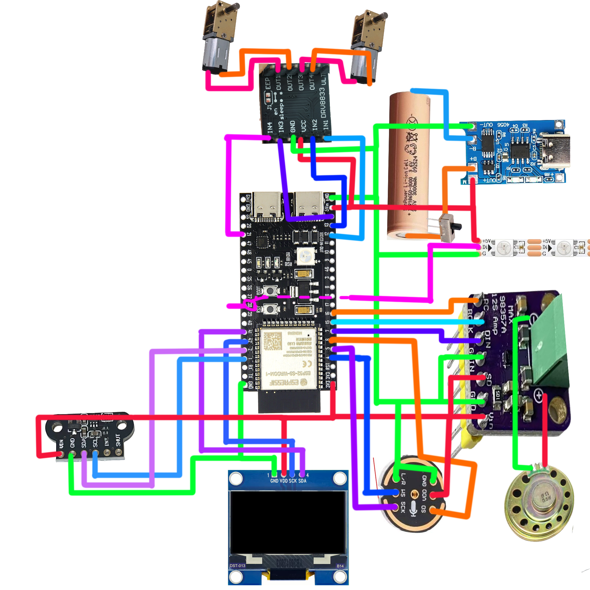

# 小智桌面机器人（ESP32-S3）

一个能看、能听、能说、能自己跑的小车机器人。基于开源项目 [xiaozhi-esp32](https://github.com/78/xiaozhi-esp32) 二次开发，把原本的静态桌面音箱改成了带眼睛表情、激光测距、避障和四种自主模式的小车。

## 它长什么样

一块 1.3 寸 SH1106 单色 OLED 装在车头，上面画两只眼睛。眼睛会跟着说话的语气变——问句变成歪头思考、感叹句变成眯眼笑、说到好笑的地方会真的笑起来。距离近了屏幕会动，撞墙之前会先停。

> **许可证说明**
>
> 本项目基于 [xiaozhi-esp32](https://github.com/78/xiaozhi-esp32)（MIT，Copyright © 2025 Shenzhen Xinzhi Future Technology Co., Ltd.）修改。
>
> 但 `main/third_party/roboeyes/` 里的 [RoboEyes](https://github.com/FluxGarage/RoboEyes) 是 **GPL-3.0-or-later**（Copyright © 2024-2025 Dennis Hoelscher），它被静态链接进同一个固件二进制。按 GPL 的传染性要求，**整个项目以 GPL-3.0 发布**，而不是 MIT。
>
> MIT 代码并入 GPL 工程是允许的（单向兼容），反之不行。所以 `LICENSE` 是 GPL-3.0 全文，不是笔误。详见 [NOTICE](NOTICE)。

## 硬件清单

| 部件 | 型号 | 数量 | 说明 |
|---|---|---|---|
| 主控 | ESP32-S3-WROOM-1 **N16R8** | 1 | 16MB Flash + 8MB PSRAM（Octal），模块内置天线 |
| 显示屏 | **SH1106 1.3 寸 OLED 128×64** | 1 | I2C 接口，4 针模块 |
| 麦克风 | **INMP441** | 1 | I2S 数字输出，24 位 |
| 功放 | **MAX98357A** | 1 | I2S 输入，3W 单声道 |
| 喇叭 | 8Ω 2W 全频 | 1 | 接 MAX98357A 输出 |
| 电机驱动 | **DRV8833** 双 H 桥 | 1 | 每路持续 1.2A，峰值 2A |
| 电机 | **N20 减速电机**（6V 版，带编码盘可选） | 2 | 减速比 1:30 或 1:50 都能用 |
| 激光测距 | **TOF050C-VL6180X** | 1 | I2C，量程 0-200mm，4 针模块 |
| 彩灯 | **WS2812B** 灯带 | 1 | 7 颗，不需要裁剪成 7 颗——驱动器只写前 7 个像素 |
| 按键 | 6×6 轻触 ×2 + TTP223 触摸模块 | 3 | BOOT / 音量增减 / 头顶触摸 |
| 电源 | 18650 锂电池 ×2 + 电池盒 | 1 | 电机独立供电，与主控共地 |

> 主控和电机**分开供电**是关键。N20 启动瞬间能到 1A 以上，和 ESP32 共用一路会把电压拉低导致复位。

## 接线表



上图是完整接线示意，下面按外设分组列出引脚对应关系。


### 显示屏（I2C0）

| 屏幕引脚 | ESP32-S3 |
|---|---|
| GND | GND |
| VCC | 3V3 |
| SCL | **GPIO 42** |
| SDA | **GPIO 41** |

### 激光测距（I2C1，独立总线）

| 模块引脚 | ESP32-S3 |
|---|---|
| GND | GND |
| VIN | 3V3 |
| SCL | **GPIO 1** |
| SDA | **GPIO 2** |

> 接了第二颗 VL6180X 时要注意：默认地址都是 `0x29`，同一总线会撞。需要把 XSHUT 拉出来分别上电改地址，而 TOF050C 分线板只引出 4 个焊盘，没有 XSHUT。这也是为什么本方案的第二颗传感器用红外避障模块而不是 VL6180X。

### 麦克风（INMP441，I2S0 接收）

| 麦克风引脚 | ESP32-S3 |
|---|---|
| VDD | 3V3 |
| GND | GND |
| L/R | GND（选左声道） |
| SCK | **GPIO 5** |
| WS | **GPIO 4** |
| SD | **GPIO 6** |

### 功放（MAX98357A，I2S0 发送）

| 功放引脚 | ESP32-S3 |
|---|---|
| VIN | 5V（3V3 也能响，音量小） |
| GND | GND |
| LRC | **GPIO 16** |
| BCLK | **GPIO 15** |
| DIN | **GPIO 7** |

### 电机驱动（DRV8833）

| DRV8833 引脚 | 接到 |
|---|---|
| VM | 电池正极（**直接接，不要过 LDO**） |
| GND | 电池负极 + ESP32 GND（**必须共地**） |
| AIN1 | **GPIO 12**（左轮正转） |
| AIN2 | **GPIO 13**（左轮反转） |
| BIN1 | **GPIO 14**（右轮正转） |
| BIN2 | **GPIO 21**（右轮反转） |
| AOUT1/AOUT2 | 左 N20 |
| BOUT1/BOUT2 | 右 N20 |
| STBY | 3V3（不接就一直休眠） |

> **VM 两端务必并一颗 220µF 电解 + 100nF 陶瓷电容**，尽量靠近模块电源脚。没有它，N20 启动的电流冲击会把电池电压瞬间拉低，表现为 ESP32 随机重启。

### 彩灯（WS2812B）

| 灯带 | ESP32-S3 |
|---|---|
| VCC | 5V |
| GND | GND |
| DIN | **GPIO 38** |

### 按键

| 功能 | GPIO | 说明 |
|---|---|---|
| BOOT | **0** | 短按开/关对话，长按切显示界面，开机时按住进配网 |
| 音量 + | **40** | |
| 音量 − | **39** | |
| 头顶触摸 | **47** | 按住说话，松开发送（TTP223 或导线直接触摸均可） |

### 板载指示灯

GPIO 48 一颗 WS2812，随设备状态变色：唤醒时蓝、说话时绿、出错时红。跟灯带是两条独立通道，互不干扰。

## 构建

### 环境

- **ESP-IDF v5.5.4**（其它 5.x 版本未测试）
- Python 3.11
- 目标芯片 `esp32s3`

### 步骤

```bash
# 1. 设置 IDF 环境
. $IDF_PATH/export.sh          # Linux / macOS
# 或 Windows：%IDF_PATH%\export.bat

# 2. 选目标
idf.py set-target esp32s3

# 3. （可选）调整配置
#    sdkconfig.defaults 里已经设好本项目的板卡和屏幕，直接用就行。
#    只有在你要改板卡或屏幕型号时才需要：
idf.py menuconfig
#   → Xiaozhi Assistant
#     → Board Type → Xiaozhi AI (桌面机器人)
#     → OLED Type  → SH1106 128*64      ← 必须选对，选错屏幕不亮

# 4. 编译
idf.py build

# 5. 烧录
idf.py -p COM3 flash monitor
```

### 两个必须注意的点

**一、改了 `BUILTIN_TEXT_FONT` 之后必须 reconfigure**

字体是在 CMake 配置阶段嵌进固件的（`file(GLOB)` 在 `configure` 时求值），只跑 `idf.py build` 不会重新打包字库。改完字体要：

```bash
idf.py reconfigure && idf.py build
```

**二、`sdkconfig.defaults` 里的 `CONFIG_FREERTOS_HZ=100`**

默认是 100Hz，一 tick 是 10ms。这意味着 `pdMS_TO_TICKS(5)` 等于 **0**，`vTaskDelay(0)` 不让出 CPU，会变成忙等。

代码里所有短延时都必须写成 `vTaskDelay(1)`（至少 1 tick = 10ms），不能用 `pdMS_TO_TICKS(小于10的毫秒数)`。本项目在 `vl6180x.cc`、`roboeyes_adapter.cc`、`rgb_strip.cc` 里都踩过这个坑。


## 接入小智平台

固件烧好之后，设备还不知道该连哪个服务器、用哪个模型、听谁的提示词。这些都由小智的控制台管。

**1. 注册控制台**

打开 <https://xiaozhi.me>，注册账号，登录后进「控制台」。

**2. 添加设备**

控制台里「添加设备」→ 选 **ESP32-S3**。记下页面给的 **6 位验证码**，下一步要用。

**3. 设备配网**

设备第一次开机会自己开热点，名字形如 `Xiaozhi-XXXX`。手机连上这个热点，浏览器会自动弹出配网页（没弹就手动打开 `192.168.4.1`），填你家 WiFi 的名字和密码。

**4. 输入验证码**

配网完成后屏幕会提示输入验证码。用鼠标滚轮、按键、或者直接对着它念数字都行——具体看你选的输入方式。

**5. 完成**

验证通过后会播一段开机音效，屏幕进入眼睛界面。之后在控制台能看到对话记录、改提示词、换模型、看设备日志。

> 如果卡在某一步，接串口看日志最直接：`esptool` 或任意串口工具，115200 波特率。配网失败会打印 `WifiBoard: Starting WiFi connection attempt` 之后跟错误码。

## 智能体提示词

**这一步不能省。** 固件里的 16 个工具（动作、表情、测距、机器人模式、彩灯）全靠模型自己决定调不调——不给提示词，它就是个会动眼睛的音箱，工具躺在固件里没人用。

完整提示词见 **[docs/提示词.md](docs/提示词.md)**，直接复制到控制台的「角色设定」里就能用。

那份提示词做了三件事：

1. **给了动作词到 `action` 的映射表**——「往前走」→ `forward`，「转个圈」→ `spin`。不写这个，模型会把「往前走」当成闲聊回你一句「好的」
2. **强调「必须真的调工具」**——模型很爱只说不做
3. **写明做不到什么**——不能放音乐、不能拍照。不写的话它会编

它是我自己测出来能用的版本，不是标准答案。你可以按自己的喜好改说话风格，工具列表别动就行。

## 功能

### 显示

三种界面，用 BOOT 键长按切换：

| 界面 | 内容 |
|---|---|
| 眼睛 | 整屏两只眼睛，会随机游走、眨眼、跟随情绪变形 |
| 官方 | 小智原版的界面：状态栏 + 状态字 + 聊天字幕（可滚动） |
| 大时钟 | 进入待机 60 秒后自动切换，显示 `HH:MM` 和日期，秒冒号每秒闪 |

### 表情

26 种情绪名，底层是 5 种 mood（DEFAULT / TIRED / ANGRY / HAPPY / SURPRISED）加 6 个开关（idle 游走、curiosity、水平 flicker、垂直 flicker、汗滴、laugh/confused 动画）的组合。

除了服务端下发的 emotion，还会从每句话的文本推断语气：句尾问号→思考、感叹号→开心、含"哈哈"→笑、含"为什么"→困惑。

### 测距与安全

VL6180X 20Hz 采样，四级阈值（都可 Web 配）：

```
< 80mm    停车 + 响提示音（5cm 音效）
80-100mm  迟滞区，保持停车
100-120mm 限速 70% + 响提示音（10cm 音效）
> 140mm   正常
```

阈值之间的空档是迟滞带，避免在边界上反复停停走走。

**五个保护：**

1. **下发指令时检查**——障碍太近，前进指令直接拒绝
2. **运行中复查**——电机转起来之后撞上障碍，回调里立即停车
3. **超时丢弃**——读不到距离超过 1 秒，前后限速 50% 且最多走 1 秒，左右转不受限
4. **Web 遥控豁免**——页面上手动操作不受闸门限制，方便调试
5. **桌沿检测**——读数突然超过基线很多或超量程，判为悬空，立即停车后退转向

### 机器人模式

| 模式 | 行为 | 前置 |
|---|---|---|
| explore | 随机方向走 1.5-2 秒、停 1-3 秒，带音效 | 无 |
| free | 只换表情不走动 | 无 |
| follow | 目标 >100mm 前进、50-100mm 站住、<50mm 后退 | 需要传感器 |
| edge_patrol | 沿桌沿巡逻，检测到边缘就后退转向 | 需要传感器 |

运行期间不休眠；语音唤醒时暂停，说完话自动继续并先做一次原地转身校准。

### Web 控制台

设备联网后浏览器打开 `http://<设备IP>/`：

| 页面 | 内容 |
|---|---|
| `/` | 虚拟摇杆、动作按钮、实时距离、音量滑条、静音 |
| `/robot` | 四种模式启停、传感器状态 |
| `/sensor` | 实时距离、四级阈值配置、基线校准 |
| `/system` | 按住说话、模拟 BOOT 短按/长按、重启 |
| `/config` | 电机动作时长、默认速度、跟随与巡检参数 |

### 串口终端

COM3 上一个 `xiaozhi>` 提示符，九个命令：

```
help     列命令
status   芯片/IDF/运行时长/显示界面/机器人模式/传感器/heap
heap     内部 RAM、PSRAM 各段余量
tasks    17 个任务的状态、优先级、核、栈剩余
log      改日志等级
motor    手动驱动电机
robot    切机器人模式
sensor   读一次距离
reboot   软重启
```

不用反复烧录就能查状态、调参数。

## 版本

当前版本 **V224-5.2**。

`V224` 表示基于官方 [xiaozhi-esp32](https://github.com/78/xiaozhi-esp32) 2.2.4。横杠后面走 `<阶段>.<序号>`：一个功能算一级，改 bug、调参数、换打包方式都不进版本号。

| 阶段 | 能做什么 | 序号 | 功能 |
|---|---|---|---|
| **1.x** | 能亮、能动 | 1.1 | 板卡骨架 + SH1106 亮屏 |
| | | 1.2 | DRV8833 电机驱动 + 动作工具 |
| | | 1.3 | 开机音效、就绪音效 |
| | | 1.4 | RoboEyes 眼睛动画 |
| **2.x** | 能交互 | 2.1 | Web 遥控（摇杆、动作按钮） |
| | | 2.2 | WS2812 灯带（5 个槽位、gcode 语法） |
| | | 2.3 | 三种显示界面（睡眠大时钟 / 眼睛 / 官方） |
| **3.x** | 有感知 | 3.1 | VL6180X 测距（20 Hz、三级自愈） |
| | | 3.2 | 安全闸门（四级阈值、桌沿检测、保护性停车） |
| | | 3.3 | 机器人四模式（探索 / 自由 / 跟随 / 边缘巡检） |
| **4.x** | 有性格 | 4.1 | 语气联动（按句尾标点和关键词切表情） |
| | | 4.2 | 音乐界面（识别 `% play_music` 与书名号） |
| | | 4.3 | 音量与静音 |
| | | 4.4 | Web 多页面（机器人 / 测距 / 系统 / 电机） |
| **5.x** | 好用、好发 | 5.1 | 串口控制台（9 个命令） |
| | | 5.2 | 单文件固件镜像 |

**规则**

- **阶段号只增不减。** 新功能一律进当前最高阶段，并在该阶段序号上 +1。上表记录的是每个阶段当时做了什么，不是「这个功能属于第几阶段」的分类表。
- 所以下一步如果加后向避障，版本是 `V224-5.3`，不是 `V224-3.4`。
- 修 bug、调参数、改文档、换打包方式都不动版本号；只有「能多做到一件以前做不到的事」才 +1。
- 跨大阶段（比如 5.x 走完开始做语音唤醒词训练，变成 6.x）时，序号从 1 重新开始。

## 已知限制

- **眼睛和 LVGL 不能同屏**：眼睛是直接往 panel 写，LVGL 有自己的渲染管线，两者切换时会闪一下。做分屏试图解决过，代价是字幕把眼睛刷掉导致持续闪烁，已放弃。
- **字库占 1.7MB**：`font_puhui_14_1` 是完整字库，分区只剩 23%。想省空间可以换回 `font_puhui_basic_14_1`，但那个精简库缺「播放」「歌名」这些字，且**缺字不报错，只是画不出来**。
- **N20 电机 40% 以下占空比带不动**：电池电压掉下来时更明显。所有速度参数默认 55 以上，改低了自己承担。
- **抓串口会复位设备**：CH343 的 DTR/RTS 拉低会拉 EN 脚。想保持设备运行就别开串口。
- **服务端可能不发 `tts stop`**：极端情况下会卡在说话状态。固件里加了兜底：播放队列空 3 秒自动退回聆听。
- **音乐界面靠文本识别**：服务端推 `% play_music` 和 `《歌名》` 来触发，格式一改就失效。

## 许可证

**本项目整体以 GPL-3.0 发布。**

上游 [xiaozhi-esp32](https://github.com/78/xiaozhi-esp32) 是 MIT，但 `main/third_party/roboeyes/src/FluxGarage_RoboEyes.h` 是 **GPL-3.0-or-later**（Copyright © 2024-2025 Dennis Hoelscher）。它和其余代码静态链接成同一个固件，按 GPL 条款整体必须以 GPL-3.0 分发。

MIT 部分照抄保留原声明，见 `NOTICE`。

## 致谢

- [xiaozhi-esp32](https://github.com/78/xiaozhi-esp32) —— 整个语音交互框架
- [FluxGarage RoboEyes](https://github.com/FluxGarage/RoboEyes) —— 眼睛动画
- [ESP-IDF](https://github.com/espressif/esp-idf) / [esp_lvgl_port](https://github.com/espressif/esp-bsp) / [sh1106-esp-idf](https://github.com/tny-robotics/sh1106-esp-idf) —— 底层驱动
